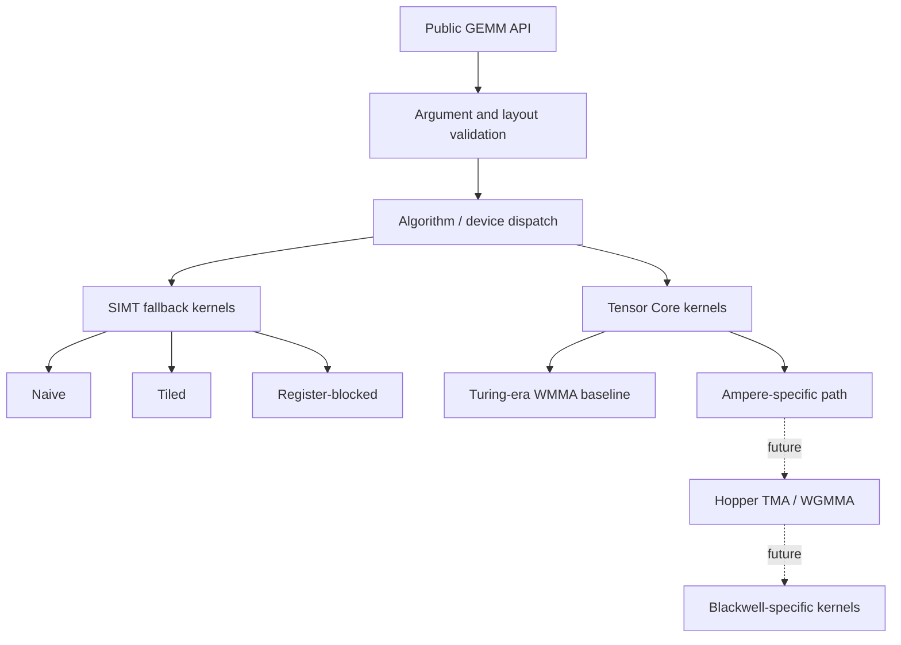

<div align="center">

# gemm-foundry

### An Architecture-Aware GPU Matrix Multiplication and Optimization Framework

A CUDA C++ GEMM library and engineering project exploring how matrix multiplication evolves from foundational SIMT kernels to architecture-specialized NVIDIA GPU implementations.

<p>
  
  
  
  
</p>

**Author:** [Sanjog Santra](https://github.com/sanjog1000)

[Overview](#overview) · [Project status](#project-status) · [Architecture](#architecture-and-kernel-strategy) · [Build](#building) · [API](#minimal-api-example) · [Testing](#correctness-and-testing) · [Benchmarking](#benchmarking) · [Roadmap](#roadmap)

</div>

---

## Overview

**gemm-foundry** is an architecture-aware GPU matrix multiplication framework focused on implementing, understanding, and evaluating GEMM kernels across NVIDIA GPU generations.

GEMM—general matrix multiplication—computes a matrix product with scaling:

\[
C \leftarrow \alpha\,\operatorname{op}(A)\operatorname{op}(B) + \beta C
\]

where `op(A)` and `op(B)` may be transposed views of the input matrices. GEMM is a foundational operation in deep learning, scientific computing, numerical workloads, and many high-performance computing applications.

The project's central goal is not merely to call a high-level matrix multiplication routine. It is to build a clear, extensible implementation that exposes the engineering trade-offs behind:

- SIMT execution, tiling, and register reuse;
- data representation versus accumulation precision;
- Tensor Core programming interfaces and matrix instructions;
- global-memory traffic, shared-memory staging, and asynchronous pipelines;
- hardware capability detection and architecture-aware algorithm selection;
- correctness-first development and reproducible performance evaluation.

The implementation is under active development. Features are labelled by their current status below; **planned architecture work is not represented as completed or benchmarked**.

## Project status

| Component | Current status | Notes |
|---|---|---|
| Naive SIMT GEMM | Implemented | Baseline kernel; FP32 correctness scenarios pass. |
| Shared-memory tiled GEMM | Implemented | Uses shared-memory input tiles and cooperative loading. |
| Register-blocked GEMM | Implemented | Computes multiple outputs per thread to increase data reuse. |
| FP32 correctness suite | Initial suite passing | 15 scenarios passed across the three SIMT algorithms on an NVIDIA Tesla T4; this is a baseline, not exhaustive validation. |
| FP64 / FP16 / FP8 dispatch paths | Present in the current implementation | Expanded numerical testing for these types remains pending. |
| Turing WMMA Tensor Core path | In integration / validation | Source is being integrated; build and runtime correctness must be confirmed before treating it as validated. |
| Ampere-specific optimization | In progress | Asynchronous tile movement and pipelining are being developed; compilation, correctness, and performance are not yet validated. |
| `Algorithm::automatic` | Initial heuristic in development | Needs build validation and benchmark-guided tuning before it should be relied on for performance decisions. |
| Hopper-specific kernels | Planned | TMA/WGMMA work requires suitable Hopper hardware for runtime validation. |
| Blackwell-specific kernels | Planned | Requires supported toolkit targets and suitable hardware for runtime validation. |
| Performance benchmarks | Planned | No performance claims or benchmark results are published yet. |

The current FP32 test suite covers irregular dimensions, transpose combinations, a batched case, and several `alpha`/`beta` settings. Other data types, additional edge cases, memory-safety checks, and architecture-specific paths still need broader validation.

## Architecture and kernel strategy

The library is being organized into a stable public API, a dispatch layer, a portable SIMT baseline, and isolated architecture-specific implementations.



### Current algorithm families

| Algorithm | Main idea | Intended role |
|---|---|---|
| `Algorithm::naive` | One thread computes one output element and loops across the reduction dimension. | Simple reference-style baseline. |
| `Algorithm::tiled` | Blocks cooperatively stage tiles of A and B in shared memory. | Reuse input values and reduce repeated global-memory loads. |
| `Algorithm::register_blocked` | Each thread maintains multiple output accumulators. | Increase reuse and reduce some per-output overhead. |
| `Algorithm::tensor_core` | Selects the FP16 Tensor Core path when the implementation and runtime conditions support it. | Explicit experimental Tensor Core selection. |
| `Algorithm::automatic` | Uses an initial device/type/shape heuristic to select a concrete algorithm. | Long-term convenience entry point; current heuristic is not benchmark-tuned. |

Kernel selection is not a substitute for capability checks. Architecture-specific kernels must only be launched on devices and for input layouts they actually support. Unsupported or ineligible cases should use a validated fallback instead.

### NVIDIA architecture compatibility and implementation status

The project targets **NVIDIA GPUs only**. The build can include multiple architecture targets, but a compiled target does not mean every optimized kernel is implemented or runtime-validated on that architecture.

| NVIDIA architecture | Compute capability examples | Project status |
|---|---:|---|
| Turing | SM75 (e.g. Tesla T4) | SIMT baseline exercised on a T4. The FP16 WMMA path is being integrated and still requires build/runtime validation. |
| Ampere | SM80 / SM86 (e.g. A100 / A10) | Current optimization focus: asynchronous global-to-shared movement and pipelined Tensor Core work. Not yet validated. |
| Ada Lovelace | SM89 (e.g. RTX 40 series) | Build target may be enabled; no Ada-specific kernel is claimed. |
| Hopper | SM90 (e.g. H100) | Planned TMA/WGMMA path; runtime testing depends on access to suitable hardware. |
| Blackwell | SM100 / SM120 families | Planned; requires a CUDA Toolkit that supports the selected architecture targets. |

For official hardware-to-compute-capability mappings, see NVIDIA's [CUDA GPU Compute Capability table](https://developer.nvidia.com/cuda/gpus). CUDA Toolkit versions differ in which architectures they can compile for; see NVIDIA's [CUDA Toolkit and architecture matrix](https://docs.nvidia.com/datacenter/tesla/drivers/cuda-toolkit-driver-and-architecture-matrix.html).

**Hardware-access policy:** development and correctness work should progress on the GPU that is available. H100 access is useful for Hopper validation, but limited H100 availability does not block implementation, code review, SIMT testing, or benchmark-harness development. Hopper performance claims will only be added after execution on suitable hardware.

## Design principles

### 1. Keep the baseline useful

The SIMT kernels remain available as explicit choices and as fallback implementations. A specialized kernel should extend the library, not silently replace working code before its correctness and compatibility are established.

### 2. Separate storage precision from accumulation precision

FP16 and FP8 values can be stored compactly while using FP32 accumulation for supported paths. The storage type, multiplication path, accumulator type, output type, and any dequantization scaling are distinct parts of the numerical contract.

### 3. Isolate architecture-specific code

Turing WMMA, Ampere asynchronous movement, Hopper TMA/WGMMA, and future Blackwell work should remain separately identifiable. Each implementation must have clear architecture requirements and a fallback policy.

### 4. Correctness before performance

New kernels must be compared with a reference implementation and checked on irregular shapes and supported layouts before performance results are considered meaningful.

### 5. Benchmark with context

Performance depends on the GPU, toolchain, matrix dimensions, datatype, kernel launch overhead, memory traffic, and measurement method. Any future result will report the conditions needed to interpret it; the project will not invent performance numbers or imply that untested hardware has been benchmarked.

## Supported operation model

The public interface uses row-major matrices and supports transpose flags, leading dimensions, and batched operation through `GemmOptions`.

For the usual non-transposed case:

- A has logical shape `M × K`;
- B has logical shape `K × N`;
- C has logical shape `M × N`;
- `lda`, `ldb`, and `ldc` are measured in **elements**, not bytes;
- batch strides are also measured in elements.

The operation is:

`C = alpha * (scale_a * scale_b * op(A) * op(B)) + beta * C`

For non-FP8 inputs, the current validation requires the scale values to remain `1.0`. For FP8 inputs, scales must be finite and strictly positive. Exact numerical behavior and supported combinations should be checked against the implementation as it evolves.

### Data-type combinations in the current dispatch

| A | B | C | Current implementation status |
|---|---|---|---|
| FP32 | FP32 | FP32 | Implemented; covered by the current baseline correctness suite. |
| FP64 | FP64 | FP64 | Dispatch path present; expanded correctness tests pending. |
| FP16 | FP16 | FP16 | Dispatch path present; expanded correctness tests pending. |
| FP16 | FP16 | FP32 | Dispatch path present; expanded correctness tests pending. |
| FP8 E4M3 | FP8 E4M3 | FP16 / FP32 | Dispatch path present; numerical tests pending. |
| FP8 E4M3 | FP8 E5M2 | FP16 / FP32 | Dispatch path present; numerical tests pending. |
| FP8 E5M2 | FP8 E4M3 | FP16 / FP32 | Dispatch path present; numerical tests pending. |
| FP8 E5M2 | FP8 E5M2 | FP16 / FP32 | Dispatch path present; numerical tests pending. |

This table describes the current dispatch surface, **not a claim that every type/algorithm combination has been exhaustively validated**. The Tensor Core algorithm currently targets FP16 inputs only; other input types should use a compatible algorithm.

## Repository layout

The key source directories are organized by role:

```text
gemm-foundry/
├── include/
│   └── gemm_foundry/       # Public API, options, type traits
├── src/
│   ├── gemm.cu             # Validation, dispatch, kernel launchers
│   ├── kernels/            # SIMT kernels and precision helpers
│   ├── tensor_cores/       # WMMA Tensor Core baseline
│   └── ampere/             # Ampere-specific optimization work
├── examples/               # Small runnable API examples
├── tests/                  # Correctness test drivers
├── benchmarks/             # Performance experiments; still evolving
├── CMakeLists.txt
└── LICENSE
```

Some architecture directories and benchmark infrastructure are works in progress. The layout is intended to keep the public API separate from internal kernel implementations.

## Requirements

- **CMake:** 3.24 or newer.
- **CUDA Toolkit:** 11.8 or newer for the current FP8 type headers and CUDA build setup.
- **C++ toolchain:** a compiler supported by the selected CUDA Toolkit. On Windows, this normally means a compatible Visual Studio/MSVC toolchain.
- **GPU for runtime testing:** a compatible NVIDIA GPU and driver. A GPU is not required merely to edit the sources; compiling without GPU access depends on having `nvcc` and a supported host compiler installed.

CUDA 13 removed offline compilation support for pre-Turing Maxwell, Pascal, and Volta targets. This project currently uses Turing (SM75) as its baseline target; supporting older GPUs would require a separate older-toolkit build strategy. See NVIDIA's [CUDA 13.0 release notes](https://docs.nvidia.com/cuda/archive/13.0.0/cuda-toolkit-release-notes/index.html).

## Building

Choose architecture targets appropriate for the installed CUDA Toolkit and the GPUs you intend to support. For a first local compile, a single target is easier to diagnose than a multi-architecture build.

### Windows — PowerShell

From the repository root:

```powershell
cmake -S . -B build `
  -DGEMM_FOUNDRY_BUILD_EXAMPLES=ON `
  -DGEMM_FOUNDRY_BUILD_TESTS=ON `
  -DGEMM_FOUNDRY_CUDA_ARCHITECTURES="75-real"

cmake --build build --config Release --parallel 2
ctest --test-dir build -C Release --output-on-failure
```

If configuration has cached a previous architecture value, explicitly pass `GEMM_FOUNDRY_CUDA_ARCHITECTURES` as shown. A successful build confirms compilation and linking; runtime tests must be run on a compatible NVIDIA GPU.

If a matching example target was built, the basic example is typically located at:

```powershell
.\build\Release\gemm_foundry_basic.exe
```

### Linux — Bash

```bash
cmake -S . -B build \
  -DCMAKE_BUILD_TYPE=Release \
  -DGEMM_FOUNDRY_BUILD_EXAMPLES=ON \
  -DGEMM_FOUNDRY_BUILD_TESTS=ON \
  -DGEMM_FOUNDRY_CUDA_ARCHITECTURES="75-real"

cmake --build build --parallel 2
ctest --test-dir build --output-on-failure
```

The project's architecture variable is passed to CMake's CUDA architecture property. It can be configured for multiple targets supported by the installed compiler. For example, an appropriate newer toolkit can compile native targets for Turing, Ampere, Ada, Hopper, and supported Blackwell compute capabilities. PTX fallback settings may improve forward compatibility, but they do not promise that every architecture-specific optimization will be available or perform optimally on every GPU.

### Optional build targets

CMake exposes these switches:

- `GEMM_FOUNDRY_BUILD_EXAMPLES` — build the example driver.
- `GEMM_FOUNDRY_BUILD_TESTS` — build and register the correctness-test driver with CTest.
- `GEMM_FOUNDRY_BUILD_BENCHMARKS` — reserved for the benchmark driver once its source and methodology are finalized.

If an optional target's expected source file is absent, CMake intentionally reports an error instead of creating an incomplete target.

## Minimal API example

The following illustrates the public API call for a row-major FP32 GEMM. `d_A`, `d_B`, and `d_C` must already point to valid CUDA device allocations of the required sizes. Allocation, input transfer, output transfer, error handling, and cleanup are omitted here for focus.

```cpp
#include <cuda_runtime.h>
#include "gemm_foundry/gemm.hpp"

using namespace gemm_foundry;

// A: M x K, B: K x N, C: M x N; row-major storage.
// float* d_A, float* d_B, and float* d_C are device pointers.

GemmOptions options{};
options.M = 128;
options.N = 128;
options.K = 128;
options.lda = options.K;
options.ldb = options.N;
options.ldc = options.N;
options.algorithm = Algorithm::tiled;

const Status status = gemm<float, float, float>(
    options,
    d_A,
    d_B,
    d_C,
    1.0f,  // alpha
    0.0f   // beta
);

if (status != Status::success) {
    // Handle the reported library status.
}
```

The API exposes explicit algorithm selection for controlled experiments. `Algorithm::automatic` is an experimental heuristic at this stage; do not assume it is performance-optimal until it has been tuned against measurements.

## Correctness and testing

Correctness tests live in `tests/`, separate from runnable examples and benchmarks. The current baseline test driver exercises these FP32 scenarios for the naive, tiled, and register-blocked algorithms:

- irregular matrix dimensions;
- transposed A;
- transposed B with `beta = 0`;
- both inputs transposed with `beta = 1`;
- batched GEMM with multiple matrix pairs.

The current run reported **15/15 scenario-and-algorithm combinations passing** on an NVIDIA Tesla T4, with a reported maximum absolute error of zero for those test values. These tests are intentionally small and do not establish exhaustive correctness for all dimensions, datatypes, architectures, or numerical ranges.

### Remaining validation work

- edge dimensions and tile boundaries;
- padded leading dimensions and batch strides;
- FP64, FP16, and every supported FP8 combination;
- invalid arguments and error status codes;
- FP8 scale behavior and range/rounding cases;
- GPU memory safety with Compute Sanitizer where available;
- compile-time and runtime checks for each architecture-specific path;
- clean builds across supported toolchain configurations.

A new architecture-specific kernel should not be considered validated until its code compiles, passes targeted numerical checks on suitable hardware, and is checked for runtime errors. Test status will be updated as these checks are completed.

## Benchmarking

**Benchmarking is a future milestone. No speedup, throughput, latency, or performance comparison is claimed at present.** The current priority is to finish integration and establish correctness for the optimized kernels.

The benchmark harness will be designed to compare the custom implementations with a well-established baseline such as cuBLAS, where the relevant datatype and hardware are supported. Planned methodology:

1. Verify numerical correctness before timing each case.
2. Warm up kernels and use CUDA events for GPU timing.
3. Run repeated trials and report a robust statistic (such as the median), along with variability where useful.
4. Separate kernel-only timings from end-to-end timings that include transfers or setup.
5. Sweep representative square and rectangular shapes, reduction dimensions, datatypes, and batch counts.
6. Record GPU model, compute capability, driver, CUDA Toolkit, build targets, compiler options, and benchmark parameters with results.
7. Keep architecture-specific results separate instead of comparing measurements taken under materially different conditions as if they were equivalent.

Benchmark development can begin on the GPU that is available. H100-specific measurements will be added only when suitable Hopper hardware is accessible; H100 access is not assumed or required for everyday development. The aim is reproducible evidence, not a single headline number.

## Roadmap

- [x] Establish a public GEMM API and runtime dispatch structure.
- [x] Implement naive, shared-memory tiled, and register-blocked SIMT kernels.
- [x] Add an initial FP32 correctness driver and run its current cases on a Tesla T4.
- [x] Define supported input/output type combinations and FP8 scale validation in the dispatch layer.
- [ ] Finish build integration and runtime validation of the Turing-compatible FP16 WMMA path.
- [ ] Complete the Ampere-specific asynchronous-copy / double-buffering path and validate it on SM80+ hardware.
- [ ] Expand numerical and API validation for FP64, FP16, and FP8.
- [ ] Add memory-safety and repeated-run checks.
- [ ] Implement and validate Hopper-specific TMA/WGMMA kernels when suitable hardware is available.
- [ ] Add Blackwell-specific kernels and verify their build targets/toolchain requirements.
- [ ] Refine `Algorithm::automatic` using correctness constraints and measured crossover points.
- [ ] Build a reproducible benchmark suite and compare with cuBLAS.
- [ ] Document tested GPU/toolkit combinations and release stability guarantees.

The roadmap is a development plan, not a claim that all listed features are already implemented.

## Contributing and development notes

This is an actively evolving systems project. Before proposing or integrating a kernel:

1. keep the public API and numerical semantics consistent;
2. isolate architecture-specific code and document its requirements;
3. include correctness coverage for the changed path;
4. build with an explicit, supported architecture target;
5. avoid reporting speedups until measurements are repeatable and reproducible.

Issues and focused contributions are welcome. Architecture-specific implementations should identify the GPU family and CUDA Toolkit version used for validation.

## Acknowledgements and references

This project uses NVIDIA CUDA and draws on the public NVIDIA documentation for GPU programming, architecture features, and compiler behavior:

- [CUDA C++ Programming Guide](https://docs.nvidia.com/cuda/cuda-programming-guide/index.html)
- [CUDA GPU Compute Capability](https://developer.nvidia.com/cuda/gpus)
- [CUDA Toolkit and Driver / Architecture Matrix](https://docs.nvidia.com/datacenter/tesla/drivers/cuda-toolkit-driver-and-architecture-matrix.html)
- [CUDA Toolkit Release Notes](https://docs.nvidia.com/cuda/cuda-toolkit-release-notes/index.html)
- [cuBLAS Documentation](https://docs.nvidia.com/cuda/cublas/index.html) — a planned comparison baseline for future benchmarking.

These resources are acknowledgements of the tools and public technical documentation used in development; they do not imply NVIDIA sponsorship or endorsement.

## License

This project is licensed under the **Apache License 2.0**. See [`LICENSE`](LICENSE) for the complete terms.

---

<div align="center">

**gemm-foundry** · Built by [Sanjog Santra](https://github.com/sanjog1000)

*Understand the architecture. Build the kernel. Validate the result. Measure the performance.*

</div>
